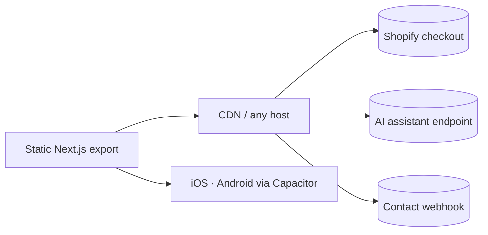

<div align="center">


<br/>


</div>

---

## ◆ At a glance

| | | | |
|:--:|:--:|:--:|:--:|
| **14**<br/><sub>departments</sub> | **47**<br/><sub>BioAro lab tests</sub> | **8**<br/><sub>bioactive formulas</sub> | **30**<br/><sub>static pages</sub> |
| **17**<br/><sub>connected biomarkers</sub> | **3**<br/><sub>global clinics</sub> | **0**<br/><sub>backend servers</sub> | **100%**<br/><sub>JSON-LD coverage</sub> |

## ◆ Architecture



No custom backend. Checkout runs on Shopify, chat on a hosted AI endpoint, everything else ships as static HTML.

## ◆ Quick start

```bash
npm install
cp .env.example .env.local
npm run dev        # localhost:3000
npm run build      # static site → ./out
```

## ◆ What's inside

| Area | Highlights |
|---|---|
| **Home** | Live AI intent engine · data fusion graph · 17-biomarker constellation · research-based longevity simulator · department intelligence · goal → plan pipeline |
| **Precision Health** | 14 departments · overview, conditions, tests & prep, care path, cited evidence, FAQ |
| **BioAro Labs** | AI intelligence flow · 10 Bio families · full catalogue · packages · test matcher |
| **BioAro Drugs** | AI protocol builder · transparent dosing charts · science & quality |
| **Global Clinic** | Journey · Virtual Clinic with 7-day BP tracker · UAE assessments · interactive world map |
| **Shop** | Plan Studio live plan builder · Test / Package / Program ladder · one search across 63 items · site-wide bag with 3/6/12-month terms · prices in CAD |
| **Xevyo AI** | Ctrl X command bar · highlight any text to ask · page-aware smart questions · voice ask · AI plan review in the bag |
| **Design** | Champagne theme · Phosphor icons · SVG charts · floating 3D particle field · Magic UI–style motion |

## ◆ Search & AI discoverability

- `sitemap.xml` and `robots.txt` generated at build — open to Google, Bing, GPTBot, ClaudeBot, PerplexityBot and Applebot
- `llms.txt` summary for AI answer engines
- schema.org JSON-LD: `MedicalOrganization`, `MedicalClinic`, `MedicalWebPage`, `FAQPage`, `BreadcrumbList`
- Per-page titles, descriptions, keywords, canonical URLs and Open Graph

## ◆ Configuration

| Variable | Purpose |
|---|---|
| `NEXT_PUBLIC_XEVYO_URL` | AI assistant endpoint |
| `NEXT_PUBLIC_XEVYO_PUBLIC_KEY` | Publishable `xk-` key — browser-safe, domain-locked |
| `NEXT_PUBLIC_SHOPIFY_STORE_DOMAIN` | Enables Shopify cart permalinks |
| `NEXT_PUBLIC_CONTACT_ENDPOINT` | Contact form webhook |
| `NEXT_PUBLIC_SITE_URL` | Canonical domain |

Store settings (currency, program term prices, refund and shipping text) live in `src/config/store.ts`.

> All values are public in a static build — never store secrets in `.env`.

## ◆ Project structure

```
src/
├─ app/          routes · sitemap · robots
├─ components/   ai · charts · fx · dept · bioaro · shop · clinic · layout · ui
├─ data/         departments · labs · drugs · stats · clinic
└─ lib/          seo · commerce · catalog · intent · env
```

<div align="center">

<sub>© BioAro Inc. · Calgary · Dubai · Almelo — educational information, not medical advice.</sub>


</div>
