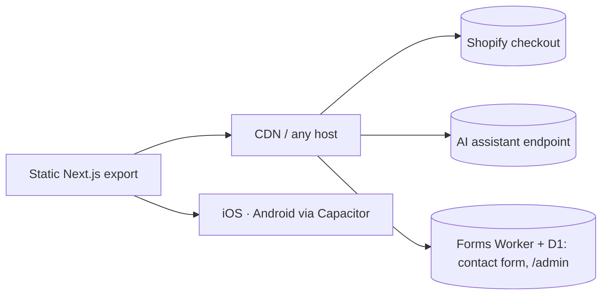

<div align="center">


<br/>


</div>

---

## ◆ v6 — Dubai clinic + International (Nov 2026)

- **`/uae/`** — Biongevity Dubai: 8 departments, 83 service pages, Book now on WhatsApp, no prices on the site, 5% VAT note.
- **`/`** — Biongevity International: longevity, technology, US launch March 2027, no clinic details.
- All content in `src/content/`; theme `clinic` in `src/styles/themes.css`; details in **[docs/V6_UAE_RELEASE.md](docs/V6_UAE_RELEASE.md)**.
- The sections below describe the earlier version and are kept for reference.

## ◆ v6.1 — Arabic + AI assistant (Nov 2026)

- **Arabic Dubai site** at `/ar/uae/…` (right-to-left, same pages and slugs), EN / ع switch in the header.
- **Biongevity AI** infrastructure on Dubai pages: launcher, chat panel, highlight-to-ask, knowledge files, hand-off. The AI itself is connected by the AI team → [`docs/AI_INTEGRATION.md`](docs/AI_INTEGRATION.md).
- **Treatment finder**, redesigned **International** page, **GTM-PH9BZ2TR** built in → [`docs/TRACKING.md`](docs/TRACKING.md).
- Full notes: [`docs/V6_UAE_RELEASE.md`](docs/V6_UAE_RELEASE.md).

## ◆ At a glance

| | | | |
|:--:|:--:|:--:|:--:|
| **14**<br/><sub>departments</sub> | **47**<br/><sub>BioAro lab tests</sub> | **8**<br/><sub>bioactive formulas</sub> | **30**<br/><sub>static pages</sub> |
| **17**<br/><sub>connected biomarkers</sub> | **3**<br/><sub>global clinics</sub> | **0**<br/><sub>backend servers</sub> | **100%**<br/><sub>JSON-LD coverage</sub> |

## ◆ Themes & AI (Biongevity 2.0)

- **One theme: Olive** — off-white, olive and soft glass. Theme colours live in `src/styles/themes.css` (Tailwind reads them as CSS variables); fixed mockup palettes live in `src/lib/theme.ts`. `npm run check:colors` fails on hard-coded hex anywhere else.
- **AI is visible everywhere** — the Xevyo orb (`components/ai/XevyoOrb.tsx`), `AIBadge`, `AISurface`, "✦ Ask about this" on every section, "Summarise this page" on every hero, a 25-second nudge, and "Your next step" at the end of every page.
- **Grounded answers** — `/site-index.json` is built at `next build`; `lib/retrieve.ts` (BM25, on-device) sends the top 3 passages to Xevyo and the chat shows them as sources. Reply language switch in the chat: English, French, Arabic, Persian.
- **New pages** — `/platform/` (digital twin overview → member app), `/tools/` (lab explainer, visit prep, specialist router), `/bioelr/` (modules + configurator → proposal), `/ai/` (governance, model cards), `/login/` (→ member app).
- **Member app** — `NEXT_PUBLIC_APP_URL` (default `https://app.biongevity.com`). The website never handles passwords.
- Copy rules: `docs/COPY_RULES.md`.

## ◆ Architecture



No server of our own to run. Checkout runs on Shopify, chat on a hosted AI endpoint, and contact enquiries on a small Cloudflare Worker that also powers the private `/admin` page (see [docs/ADMIN_FORMS.md](docs/ADMIN_FORMS.md)). Everything else ships as static HTML.

**Theme.** Colours live only in `src/styles/themes.css`: `dark` (the launch palette, set on `<html data-theme>` in the root layout) and `olive` (the earlier light theme). Switching back is that one attribute.

**Regions.** The site has two faces: International (Calgary, CAD) and UAE (Dubai, AED). `src/lib/region.ts` + `components/region/` hold the switch, the region phone and the `<Price>` component; the choice is remembered in the browser, and `/uae/` is the Dubai landing page (it pins the region). AED prices are converted at an indicative rate and marked `*` until the clinic supplies an AED list.

**Trust.** Doctors, roles and credentials come from `src/data/team.ts`; add a profile there (and a photo in `/public/team`) and it appears on the home page, the UAE page and the matching service pages.

**Tracking.** `NEXT_PUBLIC_GTM_ID` loads Google Tag Manager; booking, WhatsApp, call, enquiry and AI-nudge events are documented in [docs/TRACKING.md](docs/TRACKING.md).

**Navigation and booking.** The top bar (`components/layout/Header.tsx`) holds Services, Clinics, Programs & pricing, How it works, About, Contact and More, with Book now on the right; phones get a full-screen menu and a sticky Book bar (`MobileCta.tsx`). A fixed WhatsApp button (`WhatsAppButton.tsx`) sits bottom-right on every page (business WhatsApp +971 50 528 2566; `NEXT_PUBLIC_WHATSAPP_NUMBER` overrides it). `components/ui/BookNow.tsx` is the one place the Book now, WhatsApp and booking-band buttons are defined; every service page ends in a `BookBand`. The home page is service-first (`components/home/premium/`); the interactive AI tools moved to `/explore/`.

## ◆ Quick start

```bash
npm install
cp .env.example .env.local
npm run dev        # localhost:3000
npm run build      # static site → ./out
```

## ◆ What's inside

| Area | Highlights |
|---|---|
| **Home** | Live AI intent engine · data fusion graph · 17-biomarker constellation · research-based longevity simulator · department intelligence · goal → plan pipeline |
| **Precision Health** | 14 departments · overview, conditions, tests & prep, care path, cited evidence, FAQ |
| **BioAro Labs** | AI intelligence flow · 10 Bio families · full catalogue · packages · test matcher |
| **BioAro Drugs** | AI protocol builder · transparent dosing charts · science & quality |
| **Global Clinic** | Journey · Virtual Clinic with 7-day BP tracker · UAE assessments · interactive world map |
| **Shop** | Plan Studio live plan builder · Test / Package / Program ladder · one search across 63 items · site-wide bag with 3/6/12-month terms · prices in CAD |
| **Xevyo AI** | Ctrl X command bar · highlight any text to ask · page-aware smart questions · voice ask · AI plan review in the bag |
| **Design** | Olive theme · Phosphor icons (generated, `npm run icons`) · SVG charts · floating 3D particle field · Magic UI–style motion |

## ◆ Search & AI discoverability

- `sitemap.xml` and `robots.txt` generated at build — open to Google, Bing, GPTBot, ClaudeBot, PerplexityBot and Applebot
- `llms.txt` summary for AI answer engines
- schema.org JSON-LD: `MedicalOrganization`, `MedicalClinic`, `MedicalWebPage`, `FAQPage`, `BreadcrumbList`
- Per-page titles, descriptions, keywords, canonical URLs and Open Graph

## ◆ Configuration

| Variable | Purpose |
|---|---|
| `NEXT_PUBLIC_XEVYO_URL` | AI assistant endpoint |
| `NEXT_PUBLIC_XEVYO_PUBLIC_KEY` | Publishable `xk-` key — browser-safe, domain-locked |
| `NEXT_PUBLIC_SHOPIFY_STORE_DOMAIN` | Enables Shopify cart permalinks |
| `NEXT_PUBLIC_CONTACT_ENDPOINT` | Contact form webhook |
| `NEXT_PUBLIC_SITE_URL` | Canonical domain |

Store settings (currency, program term prices, refund and shipping text) live in `src/config/store.ts`.

> All values are public in a static build — never store secrets in `.env`.

## ◆ Project structure

```
src/
├─ app/          routes · sitemap · robots
├─ components/   ai · charts · fx · dept · bioaro · shop · clinic · layout · ui
├─ data/         departments · labs · drugs · stats · clinic
└─ lib/          seo · commerce · catalog · intent · env
```

<div align="center">

<sub>© BioAro Inc. · Calgary · Dubai · Almelo — educational information, not medical advice.</sub>


</div>
